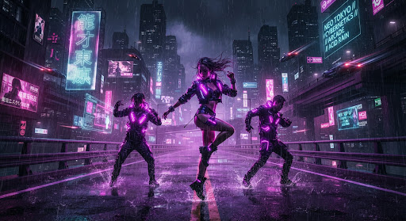
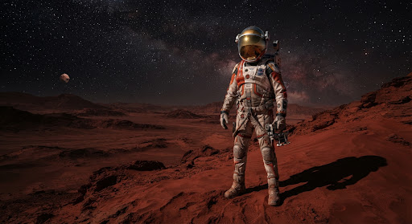

<div align="center">


# SelfieMovie

**Seja o protagonista de qualquer vídeo.**

Envie uma selfie e coloque seu rosto em clipes prontos de ação, dança e aventura,<br/>
ou descreva a cena que imaginar e receba um vídeo ou uma foto com você.

[**Ver a demo →**](https://projeto-ia-eta.vercel.app)


</div>

<p align="center">
  
  &nbsp;
  
  
  
</p>
<p align="center"><sub>Antes e depois. Imagens ilustrativas.</sub></p>

---

## Sobre o projeto

SelfieMovie é um app web pago, para celular e desktop, que transforma uma selfie em vídeo com IA. Sem programas pesados e sem edição manual: a IA coloca o seu rosto na cena.

Hoje o app está **inteiro navegável, com dados simulados**. Todas as telas, fluxos, créditos e criações funcionam no navegador. A troca pela API real de IA (Higgsfield) foi planejada para mexer em **um arquivo só**: [`src/api.js`](src/api.js).

## Como funciona

| | Passo | O que acontece |
|:-:|---|---|
| 📸 | **1. Envie sua foto** | Tire uma selfie na hora ou escolha da galeria. Rosto de frente e boa luz dão o melhor resultado. |
| 🎬 | **2. Escolha ou descreva** | Escolha um clipe pronto da biblioteca ou descreva em texto a cena que você quer viver. |
| ⬇️ | **3. Receba seu vídeo** | O resultado em HD fica pronto para baixar e postar no TikTok, Reels e Shorts, em 9:16 ou 16:9. |

## Funcionalidades

### Criar
- **Biblioteca de clipes** por categoria (Cinema, Dança, Aventura), com selos de *Em alta* e *Novidade*.
- **Criar com texto**: vídeo de 5 ou 10 segundos ou foto, com estilos visuais (cinematográfico, realista, cyberpunk, vintage, noir, fantasia).
- **Tendências** de um clique, chips de ideias e botão *Surpreenda-me*.
- **Usar este prompt**: abre o criar já preenchido a partir de uma criação.
- **Vários rostos salvos** (até 3) e **clipes em dupla**, com dois rostos na mesma cena.
- **Espera que entretém**: dicas e clipes enquanto a geração roda.

### Resultado
- Assistir, **baixar** e **compartilhar** (Web Share API, com copiar link como alternativa).
- **Antes e depois**: sua selfie ao lado do resultado.
- **Legenda** opcional sobre o vídeo.
- **Nota baixa vira refazer grátis** (uma vez por criação).
- **Minhas criações** com status: pronto, gerando e com falha.

### Créditos e planos
- Créditos às claras: o que cada pacote rende, regra de reembolso e **extrato** de compras, débitos e reembolsos.
- **Falhou? Os créditos voltam.**
- **Créditos diários grátis** e **sequência de dias**, com bônus maior no 7º dia.
- **Teste grátis** de 7 dias do plano Pro Creator.
- **Retomar o pedido depois da compra**: sem saldo, a compra volta para o mesmo pedido, pronto para gerar.
- Plano tira a **marca d'água** e entra na **fila prioritária**.

### Engajamento
- **Desafio da semana** no Início, com selo em Minhas criações.
- **Conquistas** no Perfil: primeiro clipe, primeira dupla, 5 criações, 7 dias seguidos.

### Experiência
- Responsivo de verdade: sidebar no desktop, **bottom nav** no celular.
- **Tema claro, escuro ou do sistema.**
- Página 404 própria, FAQ, Termos de Uso e Política de Privacidade.

## Créditos

| Ação | Créditos |
|---|:-:|
| Clipe da biblioteca | 5 |
| Vídeo a partir de texto, 5 s | 5 |
| Vídeo a partir de texto, 10 s | 8 |
| Foto a partir de texto | 2 |
| Bônus de cadastro | **+10** |

| Plano | Preço | Créditos por mês |
|---|:-:|:-:|
| Básico | R$ 29 | 50 |
| **Pro Creator** ⭐ | R$ 69 | 180 |
| Ultra Studio | R$ 149 | 500 |

Pacotes avulsos: 20 créditos por R$ 15, 60 por R$ 39 e 150 por R$ 89.

A tabela fica em um lugar só, [`src/creditos.js`](src/creditos.js), e toda tela lê dali.

## Privacidade e confiança

O app vai vender, então o texto precisa ser honesto. Por causa do Código de Defesa do Consumidor e da LGPD:

- **Sem promessas técnicas falsas.** Nada de 4K, Dolby ou "fidelidade 99,4%". A interface diz só o que a IA entrega.
- **Consentimento obrigatório.** O botão *Usar esta foto* só libera depois de confirmar que a foto é sua e autorizar o uso. Rosto extra pede o consentimento da pessoa da foto.
- **A foto fica salva até você apagar**, com o botão *Apagar minha foto* no Perfil. Nunca é vendida.
- **A chave da API nunca vai para o navegador.** Na integração real, só uma função serverless chama a IA.
- **Sem marcas, famosos ou sósias** na biblioteca real.

## Tecnologia

- **[Vite](https://vite.dev)** multipágina, com **HTML e JavaScript puros**, sem framework. Uma página `.html` por rota.
- **[Tailwind CSS 3](https://tailwindcss.com)** compilado via PostCSS.
- Design **Cinematic Cyber-Glassmorphism**: vidro fosco, gradiente roxo para rosa, ciano para status. Fonte Plus Jakarta Sans e ícones Material Symbols. Telas desenhadas no Google Stitch.
- Estado no `localStorage`, concentrado em um módulo: [`src/store.js`](src/store.js).
- API simulada que imita o fluxo assíncrono da Higgsfield (pedido, `jobId`, consulta de status).
- Testes com **[Vitest](https://vitest.dev)** e happy-dom.
- Deploy na **Vercel**, com `cleanUrls`: cada push na `main` publica a demo.

## Como rodar

Requisito: Node.js 20 ou mais novo.

```bash
git clone https://github.com/rafaellourenco10/projeto_ia.git
cd projeto_ia
npm install
npm run dev
```

Abra `http://localhost:5173`.

| Comando | O que faz |
|---|---|
| `npm run dev` | Servidor de desenvolvimento |
| `npm run build` | Build de produção em `dist/` |
| `npm run preview` | Serve o build localmente |
| `npm test` | Roda os testes |

> **Dica de teste:** adicione `?debug=falha` na URL antes de gerar para simular uma geração que falha e ver o reembolso dos créditos.

## Estrutura

```
├── index.html            Landing
├── entrar.html           Login e cadastro
├── inicio.html           Biblioteca de clipes
├── clipe.html            Detalhe do clipe
├── criar-com-texto.html  Criar com texto
├── gerando.html          Progresso da geração
├── resultado.html        Resultado
├── minhas-criacoes.html  Galeria de criações
├── creditos-planos.html  Saldo, planos, pacotes e extrato
├── perfil-rosto.html     Conta, rostos, tema e conquistas
├── perfil-rosto/foto.html  Envio da selfie
├── ajuda-faq.html · termos.html · privacidade.html · 404.html
├── src/
│   ├── api.js            API simulada (o único arquivo que troca na fase da IA real)
│   ├── store.js          Estado no localStorage
│   ├── creditos.js       Tabela única de créditos, planos e pacotes
│   ├── shell.js          Sidebar, header e bottom nav compartilhados
│   ├── pages/            Um script por página
│   └── data/             Clipes e desafios simulados
├── public/img/           Imagens
├── telas/                Telas originais do Google Stitch
└── docs/superpowers/     Spec, planos e backlog
```

## Roteiro

- [x] **Fase 1:** app completo e responsivo a partir das telas do Stitch, com dados simulados.
- [x] **Fases 1.5 e 1.6:** tema claro, correções de acessibilidade e de fluxo.
- [x] **Fase 2:** compartilhar, 404, extrato, recursos inspirados em pesquisa de mercado e de retenção.
- [ ] Busca e ordenação em Minhas criações, editar perfil, PWA instalável, onboarding.
- [ ] **Motor de IA real:** Higgsfield (motion transfer para a biblioteca, texto para vídeo e foto com rosto), servidor serverless, login e pagamento reais.

O backlog completo está em [`docs/superpowers/backlog-fase2.md`](docs/superpowers/backlog-fase2.md).

---

<div align="center">
<sub>Feito com IA, do design ao código. Imagens ilustrativas.</sub>
</div>
